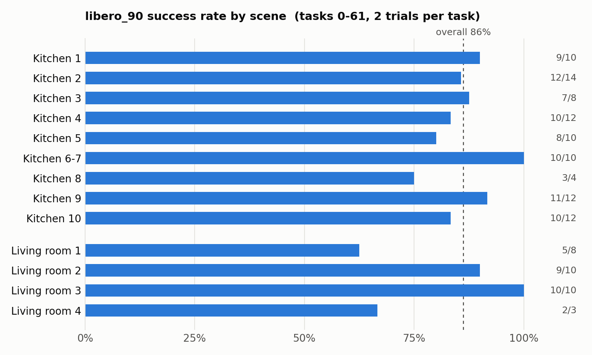
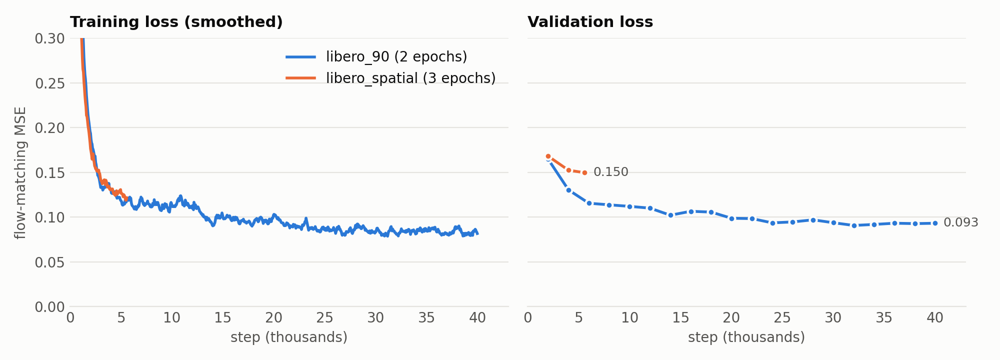

# VLA

A GR00T-N1-style vision-language-action model, trained and evaluated on [LIBERO](https://github.com/Lifelong-Robot-Learning/LIBERO). Work in progress.

```
agentview + wrist images, instruction ──► Qwen3-VL-4B (frozen, layers 1-12) ──► layer-12 hidden states
                                                                                        │ cross-attention
noisy action chunk (16 x 7) + robot state ──► flow-matching DiT (83M) ──────────────────┴──► velocity
```

- **Backbone:** Qwen3-VL-4B, frozen. It is truncated after decoder layer 12, so layers 13-36 never run.
- **Action head:** 12-block DiT with AdaLN-Zero, trained with rectified flow. It predicts 16-step action chunks and samples them with 10 Euler steps.
- **Control:** executes 8 actions per chunk, then replans.

## Results

LIBERO success rates in simulation. These are partial evaluations, not yet the full 50-trial protocol.

| Trained on | Evaluated on | Success |
|---|---|---|
| `libero_spatial` (3 epochs) | `libero_spatial`, tasks 0-1, 5 trials each | 70% (7/10) |
| `libero_90` (2 epochs) | `libero_90`, tasks 0-61, 2 trials each | 86% (106/123) |
| `libero_90` | `libero_10`, `libero_goal`, `libero_object`, `libero_spatial` (unseen tasks) | in progress |

Most failures are multi-step drawer tasks and picking one of several identical bowls ("the middle black bowl").





Validation loss is measured on 2 held-out demos per task from the training suite.

## Setup

```bash
bash setup.sh                     # conda env + PyTorch
bash scripts/setup_libero.sh      # dependencies + LIBERO simulator
bash scripts/download_libero.sh   # demos -> data/libero/ (add libero_90 to get it too)
```

## Train

```bash
python train.py                                            # spatial + object + goal + 10
python train.py "data.suites=[libero_90]" trainer.num_epochs=2
```

Any value in `configs/config.yaml` can be overridden as `section.key=value`. Checkpoints go to `checkpoints/exp_<time>/`.

## Evaluate

```bash
python eval_libero.py --checkpoint checkpoints/exp_.../last.pth --suites libero_spatial
python eval_libero.py --checkpoint ... --suites libero_10 --task_ids 0 1 --num_trials 5
```

Writes `results.json` and rollout videos next to the checkpoint.

## Layout

```
src/backbone.py      truncated, frozen Qwen3-VL
src/action_head.py   flow-matching DiT
src/models.py        VLA = backbone + action head
src/dataset.py       LIBERO HDF5 loader
src/policy.py        chunked closed-loop policy
train.py, eval_libero.py, configs/config.yaml
```
